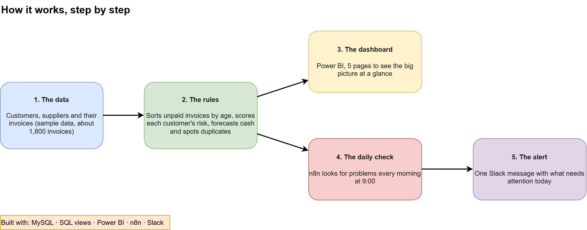
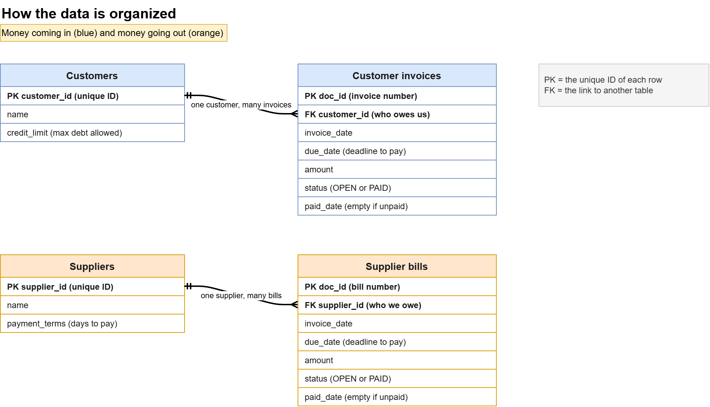
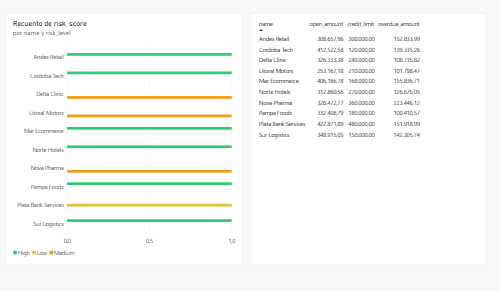
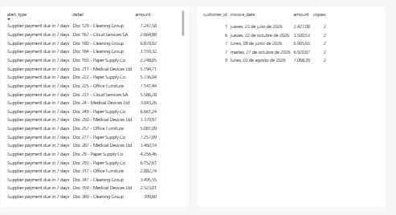

# Financial Control Tower

A small finance project that answers three everyday questions every company has:

- **Who owes us money, and for how long?**
- **Which customers are risky?**
- **Do we have enough cash for what we have to pay?**

It uses MySQL, Power BI and n8n, and sends a short summary to Slack every morning. The data is fake, built only for this demo. The structure follows the **accounts receivable / accounts payable (AR/AP)** process of SAP S/4HANA FI.



---

## What it does

| | |
|---|---|
| **Debt aging** | Groups unpaid customer invoices by how late they are: not due, 1-30, 31-60, 61-90 and 90+ days. |
| **Customer risk score** | Gives each customer a score from 0 to 100 and a level (Low, Medium, High) based on overdue debt, average payment delay and credit limit. |
| **Cash flow forecast** | Compares the money about to come in with the money about to go out over the next 30, 60 and 90 days. |
| **Problem detection** | Flags customers over their credit limit, invoices overdue for 90+ days, duplicated invoices and supplier bills due within 7 days. |

---

## The data

Four simple tables: customers, suppliers, and the invoices of each. About 1,800 invoices in total, with a mix of paid, unpaid and overdue ones.



If you know SAP, this is the same idea as its open items for customers (`BSID`) and vendors (`BSIK`), in a simplified version.

---

## The dashboard

Five Power BI pages built on top of SQL views.

### 1. Executive summary

The big numbers and the aging chart.


### 2. Debt aging

Every unpaid invoice, filterable by customer.


### 3. Customer risk

Who needs attention first.



### 4. Cash flow

Money in vs. money out.


### 5. Alerts

Problems found and duplicated invoices.



---

## The daily alert

Every morning at 9:00, an n8n workflow reads the alerts from the database and posts one message in Slack.


The message looks like this:


---

## Built with

- **MySQL** for the data and the SQL views
- **Power BI** for the dashboard
- **n8n** (running in Docker) for the daily automation
- **Slack** for the alerts

---

## Run it yourself

1. **Database:** run `sql/fi_arap.sql` in MySQL. It creates the `fi_arap` database with the tables, the data and the views.
2. **Dashboard:** open `powerbi/financial_control_tower.pbix` and point it to your MySQL server.
3. **Alerts:** import `n8n/daily_financial_alerts.json` in n8n, set your MySQL credential and replace the Slack webhook URL with your own.

---

## Project structure

```
financial-control-tower/
├── README.md
├── sql/            database, tables and views
├── powerbi/        dashboard file
├── n8n/            daily alert workflow
└── images/         diagrams and screenshots
```

---

## Why I built it

I wanted a project that mixes what I study (business administration) with what I can build (databases, dashboards and automation), around a process real companies run every day. I also wanted it to speak the language of SAP FI, which I am learning.

**Author:** Tomás Raspo
