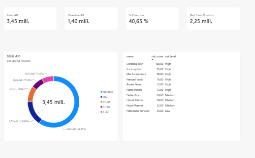
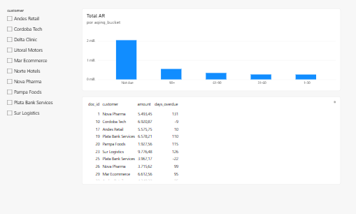
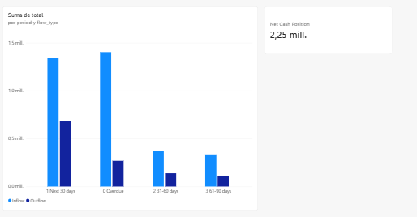
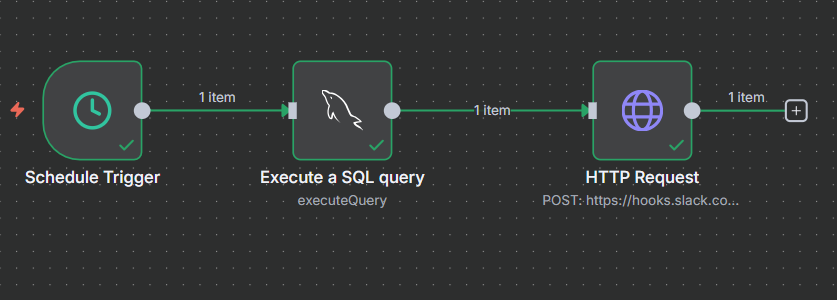
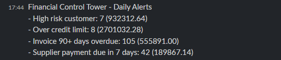

# Financial Control Tower
### Accounts receivable & payable dashboard with daily Slack alerts

[Versión en español ↓](#versión-en-español)

A small finance project that answers three everyday questions every company has:

- **Who owes us money, and for how long?**
- **Which customers are risky?**
- **Do we have enough cash for what we have to pay?**

It uses MySQL, Power BI and n8n, and sends a short summary to Slack every morning. The data is fake, built only for this demo. The structure follows the **accounts receivable / accounts payable (AR/AP)** process of SAP S/4HANA FI.


---

## What it does

| | |
|---|---|
| **Debt aging** | Groups unpaid customer invoices by how late they are: not due, 1-30, 31-60, 61-90 and 90+ days. |
| **Customer risk score** | Gives each customer a score from 0 to 100 and a level (Low, Medium, High) based on overdue debt, average payment delay and credit limit. |
| **Cash flow forecast** | Compares the money about to come in with the money about to go out over the next 30, 60 and 90 days. |
| **Problem detection** | Flags customers over their credit limit, invoices overdue for 90+ days, duplicated invoices and supplier bills due within 7 days. |

---

## The data

Four simple tables: customers, suppliers, and the invoices of each. About 1,800 invoices in total, with a mix of paid, unpaid and overdue ones.


If you know SAP, this is the same idea as its open items for customers (`BSID`) and vendors (`BSIK`), in a simplified version.

---

## The dashboard

Five Power BI pages built on top of SQL views.

### 1. Executive summary

The big numbers and the aging chart.



### 2. Debt aging

Every unpaid invoice, filterable by customer.



### 3. Customer risk

Who needs attention first.


### 4. Cash flow

Money in vs. money out.



### 5. Alerts

Problems found and duplicated invoices.


---

## The daily alert

Every morning at 9:00, an n8n workflow reads the alerts from the database and posts one message in Slack.



The message looks like this:



---

## Built with

- **MySQL** for the data and the SQL views
- **Power BI** for the dashboard
- **n8n** (running in Docker) for the daily automation
- **Slack** for the alerts
---

## Project structure

```
financial-control-tower/
├── README.md
├── sql/            database, tables and views
├── powerbi/        dashboard file
├── n8n/            daily alert workflow
└── images/         diagrams and screenshots
```

---

## Why I built it

I wanted a project that mixes what I study (business administration) with what I can build (databases, dashboards and automation), around a process real companies run every day. I also wanted it to speak the language of SAP FI, which I am learning.

**Author:** Tomás Raspo

---

## Versión en español

Un proyecto de finanzas que responde tres preguntas que se hace cualquier empresa:

- **¿Quién nos debe plata y hace cuánto?**
- **¿Qué clientes son riesgosos?**
- **¿Tenemos caja suficiente para lo que hay que pagar?**

Usa MySQL, Power BI y n8n, y manda un resumen corto a Slack todas las mañanas. Los datos son de ejemplo, armados solo para esta demo. La estructura sigue el proceso de **cuentas por cobrar y por pagar (AR/AP)** de SAP S/4HANA FI. Los diagramas y las capturas están en inglés.


### Qué hace

| | |
|---|---|
| **Antigüedad de deuda** | Agrupa las facturas de clientes sin pagar según cuánto se atrasaron: sin vencer, 1-30, 31-60, 61-90 y más de 90 días. |
| **Score de riesgo por cliente** | Le da a cada cliente un puntaje de 0 a 100 y un nivel (bajo, medio, alto) según su deuda vencida, su demora promedio de pago y su límite de crédito. |
| **Pronóstico de flujo de caja** | Compara la plata que está por entrar con la que está por salir en los próximos 30, 60 y 90 días. |
| **Detección de problemas** | Marca clientes que superan su límite de crédito, facturas con más de 90 días vencidas, facturas duplicadas y pagos a proveedores que vencen en 7 días. |

### Los datos

Cuatro tablas simples: clientes, proveedores y las facturas de cada uno. Unas 1.800 facturas en total, con una mezcla de pagadas, pendientes y vencidas.


Si conocés SAP, es la misma idea que sus partidas abiertas de clientes (`BSID`) y de proveedores (`BSIK`), en una versión simplificada.

### El dashboard

Cinco páginas de Power BI construidas sobre vistas SQL.

#### 1. Resumen ejecutivo

Los números principales y el gráfico de antigüedad.


#### 2. Antigüedad de deuda

Cada factura sin pagar, filtrable por cliente.


#### 3. Riesgo de clientes

A quién hay que atender primero.


#### 4. Flujo de caja

Plata que entra vs. plata que sale.


#### 5. Alertas

Problemas encontrados y facturas duplicadas.


### La alerta diaria

Todas las mañanas a las 9:00, un workflow de n8n lee las alertas de la base de datos y publica un mensaje en Slack.


El mensaje se ve así:


### Hecho con

- **MySQL** para los datos y las vistas SQL
- **Power BI** para el dashboard
- **n8n** (en Docker) para la automatización diaria
- **Slack** para las alertas

### Por qué lo hice

Quería un proyecto que mezcle lo que estudio (administración) con lo que sé construir (bases de datos, dashboards y automatización), alrededor de un proceso que las empresas usan todos los días. También quería que hablara el idioma de SAP FI, que estoy aprendiendo.

**Autor:** Tomás Raspo
